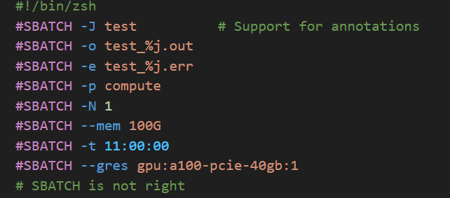
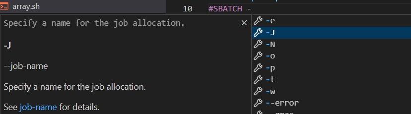
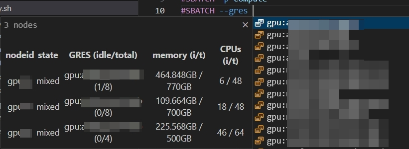
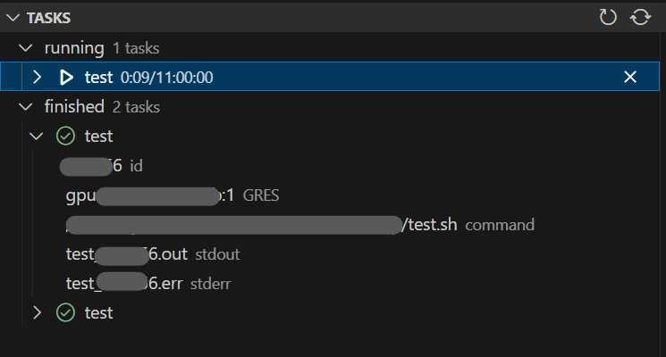
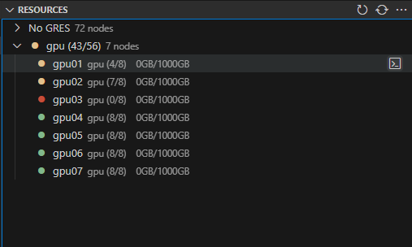
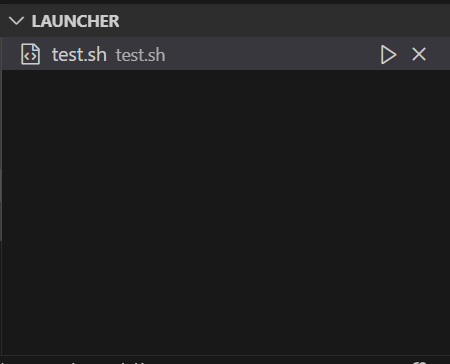
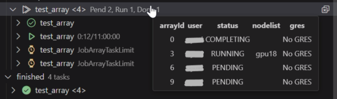

# slurm-- Extension

[](https://github.com/XingYuSSS/slurm--/blob/v0.16.0/CHANGELOG.md)
[](https://marketplace.visualstudio.com/items?itemName=xy-sss.slurm--extension)
[](https://opensource.org/licenses/MIT)

slurm-- is a multifunctional tool for SLURM syntax highlight&completion, manage tasks, view resource, and launch tasks.

We are continuously developing this extension, if there is a feature you would like to see added or if you encounter a bug, please feel free to give us feedback in [github](https://github.com/XingYuSSS/slurm--)!

## features

### syntax highlight

- Support for shell-like scripts, including `.sh`, `.slrum` or `.sbatch` files, etc.



### sbatch completion

We add `sbatch completion` at version `0.14.0`!

- Support parameters completion for 8 common params



- Support auto value completion for `partition`, `gres` and `nodelist`



### task manager

- show slurm running tasks and informations

- record running tasks, and confirm them when finished

- sort tasks by id or name

- convenient opening of log files
> Click on `stdout` or `stderr` to open the file

- select multiple running tasks and cancel them
> Select tasks by `ctrl` or `shift` and press `delete` to cancel them

- cancel all running tasks

- open an interactive shell inside a running allocation
> Click `enter allocation` on a running task, or use `enter allocation with overlap` from the context menu when your cluster requires `srun --overlap`

- [`job array` support](#job-array-support)



### resources viewer

- show availabel resources about nodes and GRES

- sort resources by name or availability

- launch terminal with chosen GRES

- copy GRES names from resource groups



### script launcher

- drop script and one-click launch task



> Drop a script from Explorer to launcher panel  
> Click on script to open the file

### Slurm command binaries

If your cluster wraps Slurm commands such as `squeue`, configure `slurm--.commands.binaries` to point the extension to the real binaries:

```json
"slurm--.commands.binaries": {
  "squeue": "/path/to/real/squeue"
}
```

Unset commands continue to use their default names.

## language support

We add multilingual support at version `0.6.0`!

Supported Languages:
- en (English)
- zh-cn (简体中文)

We welcome contributions to add more languages or improve existing translations. If you are interested in helping, please submit a pull request. Thank you for your support!

## job array support

We add `job array` support at version `0.9.0`!



## License

Slurm-- is licensed under the MIT License - see the [LICENSE](LICENSE) file for details.
